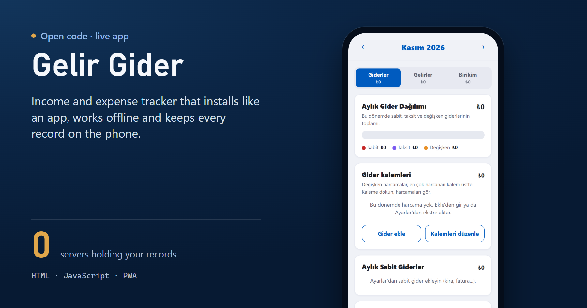

# Akıllı Gelir Gider Yöneticisi



Türkçe, tek dosyalık gelir–gider takip PWA'sı. Kurulum gerektirmez, telefona
ana ekrana eklenebilir ve **internetsiz çalışır**.

## Özellikler

- **Gider / gelir / birikim ekleme** — 16 gider kategorisi, gelir kaynağı (serbest ad), birikim & yatırım hareketi (gelir/gider sayılmaz)
- **Ana sayfada Giderler / Gelirler sekmeleri** — kaleme ve kaynağa göre toplam, dokununca o başlığın işlemleri (düzenlenebilir)
- **Birikim sekmesi** — bu ay birikime eklenen / çekilen ve net, gelirden artanla kıyas, birikim hesabı (bir kez girilen bakiye + sonraki hareketler), son 6 ayın sıfırdan yukarı/aşağı çubukları, ayın hareketleri
- **Aktarım kapsamı** — ekstre dosyası her hesabın tarih aralığını taşır; o aralıkta dosyada artık olmayan (ekstreden gelmiş, elle düzenlenmemiş) kayıtlar kaldırılır
- **Sabit aylık gelirler** — kira, maaş, burs gibi her ay beklenen gelir; aynı kaynaktan gerçek ödeme gelince onun yerine geçer (çift sayılmaz), geçmişte gelmeyen sayılmaz; Ekle → Gelir'de "Bir kez / Her ay" seçimi, Gelirler sekmesinde sabit / tek seferlik dağılımı
- **Gelir kaynakları ve gider kalemleri yönetimi** — Ayarlar'dan ekle, adını değiştir, sil (kayıtlar seçilen yere taşınır; eşleme sayesinde sonraki aktarım eski adı geri getirmez)
- **Banka ekstresinden aktarma** — dış ekstre motorunun ürettiği `gelirgider-aktarim` JSON'u birleştirerek ekler; `extId` ile tekrarları atlar, son aktarım geri alınabilir
- **Aylar arası** — Denge sayfasında son 6 dönem: gelir–gider, gider dağılımı, birikim/yatırım akışı (kütüphanesiz SVG, internetsiz çalışır)
- **Taksitlendirme** — 2–24 ay; taksit her ay otomatik olarak o ayın giderine eklenir
- **Sabit aylık giderler** — kira, fatura, aidat gibi düzenli ödemeler
- **Hesap dönemi** — ayın kaçında başlayacağını kendin seçersin (1'i, 15'i…)
- **Ana sayfa** — aylık gider dağılımı (sabit / taksit / değişken) + kalem kalem listeler
- **Denge** — gelir − gider = net durum, gider kırılımı
- **Ajanda** — günlük / haftalık / aylık geçmiş, arama, düzenleme, silme
- **Desen kilidi** — opsiyonel 3×3 desen, SHA-256 + salt ile saklanır
- **Yedekleme** — JSON olarak dışa/içe aktarma

## Veri nerede duruyor?

Tamamen **cihazında**. Bulut yok, sunucuya hiçbir şey gönderilmez.

- Birincil: **IndexedDB** (`gelirgider` veritabanı)
- Ayna: `localStorage`
- Her yazımda `rev` sürüm numarası artar; açılışta iki depodan **güncel olan** seçilir

> **Önemli:** Veri tarayıcıya ve adrese (origin) bağlıdır. Tarayıcı verilerini
> temizlersen ya da telefon değiştirirsen veri gider. Ayarlar → **Yedek Al** ile
> düzenli JSON yedeği al.
>
> Desen kilidi yedeğe **dahil edilmez** — cihaza özeldir, geri yükleme onu değiştirmez.

## Dosyalar

| Dosya | Görev |
|---|---|
| `index.html` | Tüm uygulama (HTML + CSS + JS) |
| `sw.js` | Service worker — çevrimdışı önbellek |
| `manifest.json` | PWA tanımı (ad, ikonlar, tema) |
| `icons/` | Uygulama ikonları |
| `vercel.json` | Önbellek başlıkları (`sw.js` bayatlamasın diye) |

## Yerel çalıştırma

`file://` ile açmak yeterli **değildir** — service worker ve PWA kurulumu
güvenli bağlam ister. Yerelde:

```bash
python -m http.server 8099
```

Sonra `http://localhost:8099` adresini aç.

## Sürüm güncelleme

`index.html`, `sw.js` veya ikonlar değiştiğinde `sw.js` içindeki
`CACHE` sürümünü artır (`gelirgider-v4` → `v5`), yoksa cihazlarda eski
önbellek yeni sürümü gölgeler.
